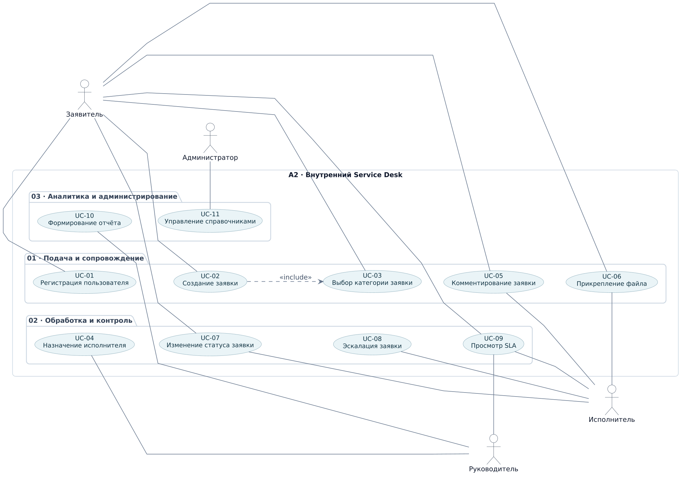

# *Service desk (концепция A2). Варианты использования*

## T1. Граница и полномочия

В границу рассматриваемого продукта — Service Desk, входит: веб-интерфейс, прикладная логика и постоянные данные модели, как одно приложение. Права доступа в системе задаются четырьмя бизнес-ролями — Заявитель, Исполнитель, Руководитель, Администратор. Роли не являются взаимоисключающими, т.е. один и тот же человек может одновременно совмещать несколько ролей. Безнес-роль — это набор полномочий, а не отдельная категория сотрудника. В UML они выступают внешними акторами, в COSMIC — функциональными пользователями, которые посылают данные в систему или получают их из неё. Внутри принятой модели системы находятся база данных, хранилище файлов и системное время. Иными словами, хранение данных, вложений и получение текущего времени считаются внутренними функциями системы, а не обращениями к внешним сервисам.

| Бизнес-роль / актор | Полномочия |
| --- | --- |
| Заявитель | Подаёт и уточняет собственные обращения, принимает предложенное решение или возвращает его в работу. |
| Исполнитель | Работает с назначенными заявками, фиксирует результат и инициирует эскалацию. |
| Руководитель | Отвечает за очередь своей службы, назначает исполнителей и анализирует SLA. |
| Администратор | Ведёт категории, их очереди и нормативы. Доступ к полному содержанию заявок для этой задачи не нужен. |

Для целей расчёта приняты следующие проектные решения, уточняющие реализацию сценариев:
* Собственная регистрация — пользователь регистрируется самостоятельно (UC-01), а не заводится администратором.
* Выбор очереди по категории — очередь обслуживания определяется выбранной категорией заявки (UC-03), отдельного ручного выбора очереди нет.
* Ручное назначение — для обычных и комплексных задач исполнителя назначает руководитель вручную (UC-04).
* Отдельная загрузка файла — вложение прикладывается отдельным действием к уже созданной заявке (UC-06), а не в момент её создания.
* Ручная эскалация — эскалацию инициирует исполнитель (UC-08); автоматической эскалации по таймеру нет.

Для SLA принимается непрерывный отсчёт без календаря смен и пауз. Срок фиксируется при создании заявки. Ограничение доступа проверяется при каждой команде с использованием роли из контекста сеанса и принадлежности заявки. Аутентификация и администрирование ролей не выделены в самостоятельные UC. Согласования и база знаний из общего описания концепции находятся за границей данной оценки.

## T2. Приложения: диаграмма и код uml

[Код в формате .puml](https://github.com/Riot1232/Project_management/blob/8fa888b6f0342c7994c37363603e36c13be75905/%D0%A4%D0%B0%D0%B7%D0%B0%203%20-%20%D0%9E%D1%86%D0%B5%D0%BD%D0%BA%D0%B0%20%D0%BF%D1%80%D0%BE%D0%B5%D0%BA%D1%82%D0%B0/Use%20cases%20%D0%B4%D0%B8%D0%B0%D0%B3%D1%80%D0%B0%D0%BC%D0%BC%D0%B0%20%D0%B8%20uml/Use_Case_Diagram.puml)

## T3–T4. Карточки сценариев

### UC-01. Регистрация пользователя

**Цель:** Получить профиль для подачи обращений.

**Актор:** Заявитель.

**Предусловия:** Сотрудник располагает корпоративным адресом. Регистрация открыта для разрешённого домена.

**Описание события:** Сотрудник отправляет регистрационные данные.

1. Сотрудник вводит имя и корпоративный адрес.
2. Service Desk нормализует адрес, затем валидирует его: соответствие регулярному выражению адреса и попадание домена в список разрешённых. После валидации выполняет поиск по уникальному индексу адреса в хранилище профилей.
3. При отсутствии совпадений профиль пользователя сохраняется, у пользователя появляется доступ к системе с правами роля Заявителя.

**Результат и постусловия:** Создан один профиль заявителя. Привилегированные роли задаются организацией заранее.

**Альтернативный ход:** Адрес, введённый в другом регистре, нормализуется до поиска по индексу, поэтому дубль не создаётся: срабатывает проверка уникальности.

**Ошибка:** Совпадение по индексу или несоответствие домену — возврат кода ошибки и причины; запись профиля не создаётся, частичных записей нет.

### UC-02. Создание заявки

**Цель:** Передать обращение в ответственную службу.

**Актор:** Заявитель.

**Предусловия:** Профиль активен. В справочнике есть категория с очередью обслуживания и нормативом срока.

**Описание события:** Сотрудник передаёт заполненную заявку.

1. Заявитель вводит тему и описание; код категории уже сохранён в состоянии формы по UC-03.
2. При отправке Service Desk нормализует текстовые поля (trim), валидирует тему и описание: непустота, ограничения длины. Перечитывает запись категории по коду из справочника, проверяет признак активности, извлекает идентификатор очереди и норматив срока.
3. Service Desk вычисляет предельный срок = момент создания + норматив (непрерывный отсчёт) и в одной транзакции сохраняет заявку: номер из последовательности, статус «Новая», идентификатор очереди, срок, ссылка на заявителя, метка времени создания.
4. Сотрудник видит номер и предельный срок решения.

**Результат и постусловия:** Создана одна запись заявки с очередью и сроком. Поле исполнителя пусто. Заявка попадает в выборку ответственной очереди по идентификатору очереди.

**Альтернативный ход:** До отправки можно выбрать другую категорию. Сохраняется последний выбор.

**Ошибка:** Деактивация категории между выбором и отправкой или пустое описание — возврат кода ошибки и причины; запись заявки не создаётся, частичных записей нет. Введённый текст и выбранная категория сохраняются в форме до исправления.

### UC-03. Выбор категории заявки

**Цель:** Выбрать действующее направление обслуживания.

**Актор:** Заявитель.

**Предусловия:** Открыта форма новой заявки.

**Описание события:** Сотрудник раскрывает список категорий.

1. Форма запрашивает список; Service Desk выполняет выборку с фильтром по справочнику категорий: активна = истина, сортировка по наименованию, проекция полей «код» и «наименование».
2. Service Desk возвращает список пар «код — наименование».
3. Сотрудник выбирает одну строку; в состоянии формы сохраняется код (не наименование) до отправки UC-02.

**Результат и постусловия:** В состоянии формы заполнено поле кода категории. Запись заявки выполняется в UC-02.

**Альтернативный ход:** Повторное раскрытие списка перезаписывает выбранный код до отправки.

**Ошибка:** Пустая выборка или недоступность хранилища — возврат сообщения с причиной; отправка без кода категории блокируется.

### UC-04. Назначение исполнителя

**Цель:** Закрепить заявку за ответственным сотрудником службы.

**Актор:** Руководитель.

**Предусловия:** Руководителю доступна очередь. Заявка находится в статусе «Новая» или «В работе».

**Описание события:** Руководитель передаёт номер заявки и идентификатор исполнителя.

1. Руководитель указывает номер заявки и идентификатор кандидата, отправляет назначение.
2. Service Desk загружает по идентификаторам запись заявки и запись профиля кандидата, сверяет: очередь заявки = очередь кандидата, профиль активен, статус заявки ∈ {«Новая», «В работе»}, роль кандидата допускает исполнение.
3. Service Desk в одной транзакции перезаписывает поле исполнителя в заявке (прежнее значение заменяется), статус не меняется, и возвращает подтверждение.

**Результат и постусловия:** Заявка закреплена за одним исполнителем.

**Альтернативный ход:** Смена исполнителя открытой заявки заменяет прежнее назначение после тех же проверок.

**Ошибка:** Несовпадение очереди, неактивный профиль или закрытая заявка — возврат кода ошибки и причины; поле исполнителя сохраняет прежнее значение, транзакция не выполняется.

### UC-05. Комментирование заявки

**Цель:** Зафиксировать уточнение или ответ по обращению.

**Акторы:** Заявитель, Исполнитель.

**Предусловия:** Заявителю принадлежит заявка либо исполнитель на неё назначен. Заявка не закрыта.

**Описание события:** Участник отправляет текст комментария.

1. Участник вводит сообщение.
2. Service Desk нормализует текст (trim), валидирует непустоту и предельную длину; загружает запись заявки и проверяет доступ по двум факторам: роль из контекста сеанса и принадлежность заявки (автор заявки либо назначенный исполнитель), а также статус ≠ «Закрыта».
3. Service Desk в одной транзакции вставляет запись комментария: внешний ключ на заявку, автор, метка времени, текст. Запись заявки не изменяется. Возвращает подтверждение.

**Результат и постусловия:** Создана отдельная запись обсуждения. Статус сохраняется.

**Альтернативный ход:** Назначенный исполнитель может ответить заявителю по тому же сценарию.

**Ошибка:** Пустой текст или статус «Закрыта» на момент проверки — возврат кода ошибки и причины; запись комментария не вставляется.

### UC-06. Прикрепление файла

**Цель:** Дополнить зарегистрированную заявку материалами.

**Акторы:** Заявитель, Исполнитель.

**Предусловия:** Существует открытая доступная заявка. Настроены допустимые типы и предельный размер файла.

**Описание события:** Участник отдельно отправляет вложение к существующей заявке.

1. Участник выбирает файл и отправляет его с номером обращения.
2. Service Desk загружает заявку, проверяет доступ (автор/назначенный исполнитель) и статус, сверяет MIME-тип и расширение по белому списку, размер — с настроенным лимитом.
3. Service Desk сохраняет содержимое в хранилище файлов и получает идентификатор/ссылку объекта; в одной транзакции вставляет запись метаданных вложения: имя, тип, размер, автор, время, ссылка на объект, внешний ключ на заявку. При сбое записи метаданных загруженный объект удаляется.
4. Service Desk возвращает подтверждение.

**Результат и постусловия:** У заявки есть запись вложения с метаданными и ссылкой на объект. При создании заявки файлы не передаются.

**Альтернативный ход:** Каждый следующий файл прикладывается повторением той же последовательности; вложения добавляются отдельными записями и не перезаписывают друг друга.

**Ошибка:** Превышение лимита, запрещённый тип или сбой сохранения — возврат кода ошибки и причины; запись вложения отсутствует, объект в хранилище удалён.

### UC-07. Изменение статуса заявки

**Цель:** Отразить ход выполнения и решение заявителя.

**Акторы:** Исполнитель, Заявитель.

**Предусловия:** Исполнитель назначен на обращение либо заявителю принадлежит решённая заявка.

**Описание события:** Участник отправляет команду перехода в новое состояние.

1. Исполнитель отправляет команду «В работу». Service Desk читает текущий статус и версию записи, проверяет роль назначенного исполнителя и допустимость перехода «Новая → В работе» по таблице переходов, обновляет поле статуса с проверкой версии.
2. Исполнитель отправляет «Решена». Service Desk проверяет переход «В работе → Решена» и в одной транзакции обновляет статус вместе с записью времени решения.
3. Заявитель отправляет «Закрыта». Service Desk проверяет, что заявитель — владелец заявки, а статус = «Решена», и выполняет переход «Решена → Закрыта». После каждой успешной команды возвращается подтверждение с новым статусом.

**Результат и постусловия:** После последней команды поле статуса = «Закрыта». Каждый промежуточный статус и время решения сохранены в хранилище между командами.

**Альтернативный ход:** При неполном решении заявитель отправляет возврат «Решена → В работе» (обратный переход в таблице); при следующем переводе в «Решена» поле времени решения перезаписывается. Поле срока не пересчитывается.

**Ошибка:** Если другой участник уже изменил состояние, сервис отклоняет устаревшую команду. Переход из «Закрыта» запрещён.

### UC-08. Эскалация заявки

**Цель:** Передать проблему руководителю очереди.

**Актор:** Исполнитель.

**Предусловия:** Исполнитель назначен на заявку в работе, активная эскалация отсутствует.

**Описание события:** Исполнитель отправляет причину эскалации.

1. Исполнитель описывает препятствие и отправляет запрос.
2. Service Desk нормализует, загружает заявку и проверяет: идентификатор исполнителя в заявке = текущий пользователь; статус = «В работе»; признак эскалации не установлен.
3. Service Desk в одной транзакции записывает в заявку причину, признак эскалации и время. Заявка начинает попадать в выборку руководителя с фильтром по признаку эскалации. Возвращает подтверждение.

**Результат и постусловия:** Заявка остаётся в работе у прежнего исполнителя. Руководитель может переназначить её через UC-04.

**Альтернативный ход:** Ручная эскалация допускается и до наступления просрочки — проверка срока в этом сценарии не участвует.

**Ошибка:** Повторная эскалация при уже установленном признаке отклоняется проверкой шага 2; вторая запись причины не создаётся.

### UC-09. Просмотр SLA

**Цель:** Узнать, соблюдён ли срок решения.

**Акторы:** Заявитель, Исполнитель, Руководитель.

**Предусловия:** Заявка видима заявителю, назначенному исполнителю или руководителю своей очереди.

**Описание события:** Участник запрашивает SLA по номеру заявки.

1. Service Desk загружает по номеру запись заявки с полями «срок», «время решения», «статус».
2. Для открытой работы сравнивает текущий момент со сроком. Для решённой или закрытой использует момент решения.
3. Service Desk возвращает срок, фактическое время (время решения либо текущий момент) и результат сравнения — «в срок» / «просрочено».

**Результат и постусловия:** Участнику доступны значения срока и результат сравнения. Запись заявки не изменяется.

**Альтернативный ход:** При возврате в работу отсчёт продолжается относительно исходного срока; часы SLA не ставятся на паузу.

**Ошибка:** Недоступный номер или заявка вне зоны видимости — возврат сообщения без раскрытия полей записи.

### UC-10. Формирование отчёта

**Цель:** Оценить поток обращений и долю просроченных в своей очереди.

**Актор:** Руководитель.

**Предусловия:** У руководителя есть закреплённая очередь. Доступна история заявок за период.

**Описание события:** Руководитель отправляет параметры отчёта.

1. Руководитель задаёт период создания заявок.
2. Service Desk валидирует параметры (корректность дат, начало ≤ окончание) и строит выборку с фильтром: идентификатор очереди = очередь руководителя, метка создания в периоде.
3. Service Desk группирует выборку по статусу, считает количество записей и долю просроченных тем же правилом сравнения, что в UC-09, на момент запроса.
4. Service Desk возвращает агрегированный результат. Отдельная запись отчёта в хранилище не создаётся — результат вычисляется на лету.

**Результат и постусловия:** Руководитель получает сводку без записи отдельного отчёта в хранилище.

**Альтернативный ход:** Для периода без заявок выводятся нулевые количества и прочерк для доли.

**Ошибка:** Начало периода позже окончания — возврат признака ошибки параметров и предложение исправить фильтр; выборка не строится.

### UC-11. Управление справочниками

**Цель:** Поддерживать действующие категории, очереди маршрутизации и нормативы.

**Актор:** Администратор.

**Предусловия:** Администратору доступна настройка категорий. У категории уникальный код, связанная очередь и положительный норматив.

**Описание события:** Администратор запрашивает список либо отправляет команду изменения справочника.

1. Администратор запрашивает полный список — Service Desk выполняет выборку без фильтра активности, включая деактивированные категории, с проекцией кода, наименования, очереди, норматива и признака активности.
2. Для новой категории Service Desk валидирует поля (непустые код и наименование, норматив > 0, существование идентификатора очереди), проверяет уникальность кода по индексу справочника и в одной транзакции вставляет запись.
3. Для существующей категории Service Desk обновляет атрибуты записи (наименование, очередь, норматив; код при переименовании не меняется) после тех же проверок.
4. Для вывода из использования Service Desk устанавливает признак активности = ложь; запись остаётся в хранилище. Возвращает подтверждение.

**Результат и постусловия:** Новая конфигурация применяется при следующем создании заявки. Уже сохранённые сроки и очереди заявок сохраняются.

**Альтернативный ход:** Деактивированная категория видна в выборке администратора (шаг 1), но отсутствует в выборке UC-03 из-за фильтра по активности.

**Ошибка:** Повторный код (совпадение по индексу), несуществующая очередь или норматив ≤ 0 — возврат кода ошибки и причины без частичной записи (транзакция откатывается). При отсутствии административных прав отклоняются и выборка списка, и любая команда изменения.

## T5. Результаты проверки полноты и согласованности сценариев

Проведенная проверка согласованности подтверждает, что модель вариантов использования Service Desk обладает необходимой целостностью и непротиворечивостью. Связи между сценариями строго регламентированы: UC-02 обязательно включает выбор категории (UC-03), при этом выбранное значение фиксируется вместе с заявкой однократно.

Мутация данных строго разграничена по сценариям: назначение изменяет исполнителя, эскалация фиксирует соответствующий признак и причину, а переход статуса меняет состояние заявки. При этом операции чтения (открытие карточки) не влекут за собой изменения этих атрибутов. Ролевая логика также соблюдена: исполнитель приступает к работе только после назначения, а закрыть решенную заявку вправе исключительно её заявитель. Все ветви с ошибками гарантируют сохранение прежнего состояния данных (транзакционность).

Кроме того, просмотр SLA и формирование отчета опираются на единое правило расчета просрочки. В UC-11 представлены самостоятельные варианты действий администратора, а в UC-07 переходы состояний выполняются по отдельным командам в течение всего жизненного цикла заявки.

Таким образом, 11 вариантов использования образуют логически завершенную и согласованную систему, где роли, данные и состояния не вступают в противоречие друг с другом.

