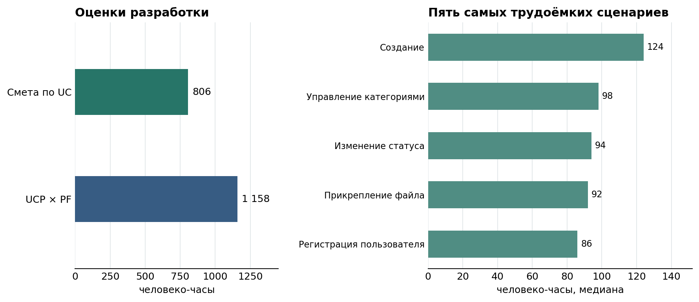

# Фаза 3. Оценка проекта A2

**Проектный менеджмент · магистратура МКН-23**  
Алина Недикова, Ольга Символокова, Никита Бредихин

## 1. Цель оценки

Определить функциональный размер будущего корпоративного Service Desk и оценить трудоёмкость первой реализации. Для проверки плановых выводов применены три разных измерения: движения данных, сложность взаимодействия с акторами и смета работ по сценариям. Часы учебной команды на подготовку оценки относятся к Фазе 2.

## 2. Проект и исходные материалы

В Фазе 1 команда выбрала концепцию A2 методами нечёткого TOPSIS и МАИ. Сотрудник регистрирует обращение, служба получает его по категории, руководитель назначает исполнителя, а участники отслеживают состояние и срок. Главный результат для заявителя — принятая и доведённая до решения заявка. Для руководителя — возможность видеть, где находится ответственность и какие обращения вышли за норматив.

## 3. Акторы и граница системы

Граница измерения охватывает веб-интерфейс, прикладную логику и постоянные данные A2 как одно приложение. Четыре бизнес-роли задают права; один человек может совмещать роли. В UML они выступают внешними акторами, в COSMIC — функциональными пользователями, которые посылают или получают данные. База данных, хранилище файлов и системное время находятся внутри принятой модели. Отдельный IAM, уведомления и внешний таймер в требованиях этих 11 UC не заданы.

| Актор | Полномочия |
| --- | --- |
| Заявитель | Подаёт и уточняет собственные обращения, принимает решение или возвращает его в работу. |
| Исполнитель | Работает с назначенными заявками, фиксирует результат и инициирует эскалацию. |
| Руководитель | Отвечает за очередь своей службы, назначает исполнителей и анализирует SLA. |
| Администратор | Ведёт категории, их очереди и нормативы. Доступ к содержанию заявок для этой задачи не нужен. |

Детализация для расчёта: собственная регистрация, выбор очереди по категории, ручное назначение, отдельная загрузка файла и ручная эскалация. Для SLA принимается непрерывный отсчёт без календаря смен и пауз. Срок фиксируется при создании заявки. Ограничение доступа проверяется при каждой команде с использованием роли из контекста сеанса и принадлежности заявки. Аутентификация и администрирование ролей не выделены в самостоятельные UC. Согласования и база знаний из общего описания концепции находятся за границей данной оценки.

## 4. Перечень вариантов использования

| Код | Сценарий | Участвующие роли |
| --- | --- | --- |
| UC-01 | Регистрация пользователя | Заявитель |
| UC-02 | Создание заявки | Заявитель |
| UC-03 | Выбор категории заявки | Заявитель |
| UC-04 | Назначение исполнителя | Руководитель |
| UC-05 | Комментирование заявки | Заявитель, Исполнитель |
| UC-06 | Прикрепление файла | Заявитель, Исполнитель |
| UC-07 | Изменение статуса заявки | Исполнитель, Заявитель |
| UC-08 | Эскалация заявки | Исполнитель |
| UC-09 | Просмотр SLA | Заявитель, Исполнитель, Руководитель |
| UC-10 | Формирование отчёта | Руководитель |
| UC-11 | Управление справочниками | Администратор |

## 5. Основные, альтернативные и негативные сценарии

UC-02 обязательно использует выбор категории. UC-03 возвращает список; значение сохраняется вместе с заявкой единожды. Назначение меняет исполнителя, эскалация — признак и причину, переход статуса — состояние. Открытие карточки само по себе не изменяет эти атрибуты. Исполнитель начинает работу после назначения; закрывает решённую заявку только её заявитель. Ветви с ошибками оставляют прежнее состояние. Просмотр SLA и отчёт используют одно правило просрочки. В UC-11 перечислены самостоятельные варианты действий администратора, а в UC-07 переходы происходят по отдельным командам в течение жизненного цикла.

### UC-01. Регистрация пользователя

**Цель.** Получить профиль для подачи обращений. **Акторы.** Заявитель.

**Предусловия.** Сотрудник располагает корпоративным адресом. Регистрация открыта для разрешённого домена.

**Событие.** Сотрудник отправляет регистрационные данные.

1. Сотрудник вводит имя и корпоративный адрес.
2. A2 проверяет формат, домен и отсутствие профиля с тем же адресом.
3. A2 сохраняет профиль с ролью заявителя и подтверждает регистрацию.

**Результат и постусловия.** Создан один профиль заявителя. Привилегированные роли задаются организацией заранее.

**Альтернативный ход.** Адрес с прописными буквами приводится к каноническому виду перед проверкой.

**Ошибка.** Занятый адрес или неверный домен вызывают сообщение с причиной. Новая запись не создаётся.

### UC-02. Создание заявки

**Цель.** Передать обращение в ответственную службу. **Акторы.** Заявитель.

**Предусловия.** Профиль активен. В справочнике есть категория с очередью обслуживания и нормативом срока.

**Событие.** Сотрудник передаёт заполненную заявку.

1. Заявитель указывает тему и описание, выбирает категорию по UC-03.
2. При отправке A2 повторно проверяет активность категории и считывает её очередь и норматив.
3. A2 присваивает номер, статус «Новая», очередь и предельный срок от момента создания. Сохраняет заявку.
4. Сотрудник видит номер и предельный срок решения.

**Результат и постусловия.** Заявка доступна ответственной очереди. Персональный исполнитель ещё не назначен.

**Альтернативный ход.** До отправки можно выбрать другую категорию. Сохраняется последний выбор.

**Ошибка.** Если категория деактивирована после выбора или нет описания, A2 возвращает причину и сохраняет введённый текст в форме до исправления.

### UC-03. Выбор категории заявки

**Цель.** Выбрать действующее направление обслуживания. **Акторы.** Заявитель.

**Предусловия.** Открыта форма новой заявки.

**Событие.** Сотрудник раскрывает список категорий.

1. A2 получает запрос доступных категорий.
2. A2 читает действующие категории и показывает названия.
3. Сотрудник выбирает одну строку. Форма хранит код до отправки UC-02.

**Результат и постусловия.** В форме заполнено поле категории. Запись заявки выполняется в UC-02.

**Альтернативный ход.** Повторное раскрытие позволяет заменить выбор до отправки.

**Ошибка.** Если список пуст или недоступен, A2 сообщает об этом. Отправка без категории блокируется.

### UC-04. Назначение исполнителя

**Цель.** Закрепить заявку за ответственным сотрудником службы. **Акторы.** Руководитель.

**Предусловия.** Руководителю доступна очередь. Заявка находится в статусе «Новая» или «В работе».

**Событие.** Руководитель передаёт номер заявки и идентификатор исполнителя.

1. Руководитель указывает исполнителя и отправляет назначение.
2. A2 читает заявку и профиль кандидата, сверяет очередь, активность и состояние.
3. A2 сохраняет исполнителя в заявке и подтверждает назначение. Статус сохраняется.

**Результат и постусловия.** Заявка закреплена за одним исполнителем.

**Альтернативный ход.** Смена исполнителя открытой заявки заменяет прежнее назначение после тех же проверок.

**Ошибка.** Кандидат из другой очереди либо закрытая заявка вызывают отказ. Предыдущее назначение сохраняется.

### UC-05. Комментирование заявки

**Цель.** Зафиксировать уточнение или ответ по обращению. **Акторы.** Заявитель, Исполнитель.

**Предусловия.** Заявителю принадлежит заявка либо исполнитель на неё назначен. Заявка не закрыта.

**Событие.** Участник отправляет текст комментария.

1. Участник вводит сообщение.
2. A2 проверяет текст и читает заявку для проверки доступа и состояния.
3. A2 сохраняет комментарий со ссылкой на заявку, временем и автором и выдаёт подтверждение.

**Результат и постусловия.** Создана отдельная запись обсуждения. Статус сохраняется.

**Альтернативный ход.** Назначенный исполнитель может ответить заявителю по тому же сценарию.

**Ошибка.** Пустой текст или закрытие заявки до отправки вызывают отказ. Комментарий не создаётся.

### UC-06. Прикрепление файла

**Цель.** Дополнить зарегистрированную заявку материалами. **Акторы.** Заявитель, Исполнитель.

**Предусловия.** Существует открытая доступная заявка. Настроены допустимые типы и предельный размер файла.

**Событие.** Участник отдельно отправляет вложение к существующей заявке.

1. Участник выбирает файл и отправляет его с номером обращения.
2. A2 читает заявку, проверяет права, тип и размер.
3. A2 сохраняет содержимое и метаданные как одно вложение и подтверждает операцию.

**Результат и постусловия.** У заявки появляется вложение. При создании заявки файлы не передаются.

**Альтернативный ход.** Каждый следующий файл прикладывается повторением того же действия.

**Ошибка.** При превышении лимита или ошибке сохранения A2 сообщает причину. Незавершённое вложение отсутствует в карточке.

### UC-07. Изменение статуса заявки

**Цель.** Отразить ход выполнения и решение заявителя. **Акторы.** Исполнитель, Заявитель.

**Предусловия.** Исполнитель назначен на обращение либо заявителю принадлежит решённая заявка.

**Событие.** Участник отправляет команду перехода в новое состояние.

1. Исполнитель переводит «Новая» в «В работе»; A2 проверяет роль, текущий статус и сохраняет переход.
2. После выполнения исполнитель переводит «В работе» в «Решена». A2 проверяет переход и фиксирует время решения.
3. Заявитель принимает решение и переводит «Решена» в «Закрыта». После каждой успешной команды A2 подтверждает изменение.

**Результат и постусловия.** После последней команды заявка закрыта. Промежуточные состояния сохраняются между командами.

**Альтернативный ход.** При неполном решении заявитель возвращает «Решена» в «В работе». При следующем решении обновляется время решения.

**Ошибка.** Если другой участник уже изменил состояние, A2 отклоняет устаревшую команду. Переход из «Закрыта» запрещён.

### UC-08. Эскалация заявки

**Цель.** Передать проблему руководителю очереди. **Акторы.** Исполнитель.

**Предусловия.** Исполнитель назначен на заявку в работе, активная эскалация отсутствует.

**Событие.** Исполнитель отправляет причину эскалации.

1. Исполнитель описывает препятствие и отправляет запрос.
2. A2 читает заявку, проверяет назначение, статус и отсутствие отметки эскалации.
3. A2 сохраняет причину и отметку в заявке. Заявка выделяется в очереди руководителя; исполнитель видит подтверждение.

**Результат и постусловия.** Заявка остаётся в работе у прежнего исполнителя. Руководитель может переназначить её через UC-04.

**Альтернативный ход.** Риск нарушения срока допускает ручную эскалацию ещё до просрочки.

**Ошибка.** Повторная эскалация той же отмеченной заявки отклоняется. Вторая запись не появляется.

### UC-09. Просмотр SLA

**Цель.** Узнать, соблюдён ли срок решения. **Акторы.** Заявитель, Исполнитель, Руководитель.

**Предусловия.** Заявка видима заявителю, назначенному исполнителю или руководителю своей очереди.

**Событие.** Участник запрашивает SLA по номеру заявки.

1. A2 получает номер и читает заявку с сохранённым сроком и временем решения.
2. Для открытой работы сравнивает текущий момент со сроком. Для решённой или закрытой использует момент решения.
3. A2 показывает срок и результат проверки.

**Результат и постусловия.** Участнику доступны сведения о сроке. Данные заявки не изменяются.

**Альтернативный ход.** При возврате в работу отсчёт продолжается относительно исходного срока; часы SLA не ставятся на паузу.

**Ошибка.** Для недоступного номера A2 выдаёт сообщение без раскрытия сведений.

### UC-10. Формирование отчёта

**Цель.** Оценить поток обращений и долю просроченных в своей очереди. **Акторы.** Руководитель.

**Предусловия.** У руководителя есть закреплённая очередь. Доступна история заявок за период.

**Событие.** Руководитель отправляет параметры отчёта.

1. Руководитель задаёт период создания заявок.
2. A2 проверяет границы периода и ограничивает выборку очередью руководителя.
3. A2 читает заявки и группирует их по статусу, рассчитывает число и долю нарушений по правилу UC-09.
4. A2 показывает агрегированный результат на момент запроса.

**Результат и постусловия.** Руководитель получает сводку без записи отдельного отчёта в хранилище.

**Альтернативный ход.** Для периода без заявок выводятся нулевые количества и прочерк для доли.

**Ошибка.** Начало периода позже окончания вызывает предложение исправить фильтр.

### UC-11. Управление справочниками

**Цель.** Поддерживать действующие категории, очереди маршрутизации и нормативы. **Акторы.** Администратор.

**Предусловия.** Администратору доступна настройка категорий. У категории уникальный код, связанная очередь и положительный норматив.

**Событие.** Администратор запрашивает список либо отправляет команду изменения справочника.

1. Администратор запрашивает полный список, включая неактивные категории.
2. Для новой категории отправляет код, название, очередь и норматив. A2 сверяет уникальность кода, сохраняет запись и подтверждает результат.
3. Для существующей категории администратор может отдельно сохранить исправленные атрибуты.
4. Для вывода из использования администратор отдельно запрашивает деактивацию. A2 сохраняет признак и подтверждает результат.

**Результат и постусловия.** Новая конфигурация применяется при следующем создании заявки. Уже сохранённые сроки и очереди заявок сохраняются.

**Альтернативный ход.** Переименование сохраняет код. Деактивированная категория видна администратору, но отсутствует в UC-03.

**Ошибка.** Повторный код, несуществующая запись или неположительный норматив вызывают отказ без частичной записи. При отсутствии административных прав A2 отклоняет запрос списка или изменения.

## 6. Функциональные процессы и размер COSMIC

Исходный черновик T7 включал 14 гипотез. После детализации исключена автоматическая эскалация по таймеру. К трём операциям изменения справочника добавлено самостоятельное чтение полного административного перечня (UC-11, шаг 1). Оно отличается от публичного списка UC-03 целью, правами и составом данных. Итоговое число процессов совпало с числом кандидатов случайно. Эскалация меняет заявку, передача результата руководителю через внешнюю службу не предусмотрена.

Загрузка списка в UC-03 считается один раз, включая вызов из UC-02. Повторное чтение категории при сохранении заявки — другое событие с проверкой актуальности и получением норматива. Переходы UC-07 — повторения одного типа команды с одной группой данных и общей таблицей разрешённых переходов. В UC-11 создание, изменение и деактивация имеют разные бизнес-события и постусловия. Содержимое файла и его метаданные описывают одно вложение. Расчёт SLA, сортировка и группирование не создают дополнительных движений.

| Процесс | UC | Реакция системы | E | X | R | W | CFP |
| --- | --- | --- | --- | --- | --- | --- | --- |
| FP-01 | UC-01 | Регистрация | 1 | 1 | 1 | 1 | 4 |
| FP-02 | UC-02 | Создание заявки | 1 | 2 | 1 | 1 | 5 |
| FP-03 | UC-03 | Получение активных категорий | 1 | 2 | 1 | 0 | 4 |
| FP-04 | UC-04 | Назначение | 1 | 1 | 2 | 1 | 5 |
| FP-05 | UC-05 | Публикация комментария | 1 | 1 | 1 | 1 | 4 |
| FP-06 | UC-06 | Загрузка вложения | 1 | 1 | 1 | 1 | 4 |
| FP-07 | UC-07 | Переход состояния | 1 | 1 | 1 | 1 | 4 |
| FP-08 | UC-08 | Ручная эскалация | 1 | 1 | 1 | 1 | 4 |
| FP-09 | UC-09 | Чтение SLA | 1 | 2 | 1 | 0 | 4 |
| FP-10 | UC-10 | Сводка по очереди | 1 | 2 | 1 | 0 | 4 |
| FP-11 | UC-11 | Просмотр полного справочника | 1 | 2 | 1 | 0 | 4 |
| FP-12 | UC-11 | Создание категории | 1 | 1 | 1 | 1 | 4 |
| FP-13 | UC-11 | Изменение категории | 1 | 1 | 1 | 1 | 4 |
| FP-14 | UC-11 | Деактивация категории | 1 | 1 | 1 | 1 | 4 |
| Итого |  |  | 14 | 19 | 15 | 10 | 58 |

Всего **58 CFP**. При создании заявки один ввод описывает заявку, один Read проверяет категорию и получает норматив, один Write сохраняет обращение. Две Exit соответствуют содержательному результату (номер и срок) и совокупности сообщений об ошибках. Поэтому FP-02 даёт 5 CFP. По модели простое добавление поля в данные той же заявки не обязано увеличивать размер. Полный журнал причин по всем движениям приведён в [расчёте COSMIC](COSMIC_расчёт.md).

## 7. Оценка по Use Case Points

Транзакция — законченный обмен намерением и наблюдаемым ответом A2. Включаем содержательные альтернативы со своей целью; повтор после ошибки, обработка формы и внутренние проверки входят в исходный обмен. UC-03 учтён отдельно от UC-02. В UC-07 различаются четыре результата для ролей (взять в работу, передать решение, принять, вернуть). Для COSMIC это один параметризованный тип изменения заявки; UCP описывает варианты взаимодействия человека с системой.

| Код | Сценарий | Транзакций | Класс | Вес |
| --- | --- | --- | --- | --- |
| UC-01 | Регистрация пользователя | 1 | Simple | 5 |
| UC-02 | Создание заявки | 1 | Simple | 5 |
| UC-03 | Выбор категории заявки | 1 | Simple | 5 |
| UC-04 | Назначение исполнителя | 1 | Simple | 5 |
| UC-05 | Комментирование заявки | 1 | Simple | 5 |
| UC-06 | Прикрепление файла | 1 | Simple | 5 |
| UC-07 | Изменение статуса заявки | 4 | Average | 10 |
| UC-08 | Эскалация заявки | 1 | Simple | 5 |
| UC-09 | Просмотр SLA | 1 | Simple | 5 |
| UC-10 | Формирование отчёта | 1 | Simple | 5 |
| UC-11 | Управление справочниками | 4 | Average | 10 |

Четыре роли работают через GUI. UAW = 12, UUCW = 65, UUCP = 77. Из 13 технических факторов наибольшее влияние в нашей конфигурации имеют эффективность оператора и параллельные изменения. Сумма вкладов равна 24,5, откуда TCF = 0,845. Восемь факторов окружения дали 17,0, ECF = 0,890. Частичная занятость и сложность языка включены с отрицательными весами.

UCP = 77 × 0,845 × 0,890 = **57,90785**. Используем исходную гипотезу Карнера PF = 20 ч/UCP. Она даёт **1 158,16 чел.-ч**. При PF = 15–25 диапазон составляет 868,62–1 447,70 чел.-ч. При фиксированном PF = 20 и рейтинге стабильности требований 2 вместо 3 получаем 1 236,23 ч. Оценки факторов, их веса, обоснования и проверка чувствительности приведены в [расчёте UCP](UCP_расчёт.md).

## 8. Экспертная расчётная модель

Оцениваются анализ правил, макеты и реализация интерфейса, прикладная логика, постоянные данные, обработка ошибок, функциональные и интеграционные тесты и минимальный выпуск внутреннего сервиса. Общие работы распределены один раз: каркас приложения и среда — UC-01, базовая модель заявки и тестовый стенд — UC-02, настройка хранения файлов — UC-06, выпуск и сквозная приёмка — UC-11. Нет отдельной надбавки за эти работы. Длительное сопровождение, перенос исторических данных, закупки, SSO и внешние интеграции в объём не вошли.

В экспертной оценке участвовали Алина Недикова, Ольга Символокова и Никита Бредихин. Участники рассмотрели оценки реализации 11 согласованных вариантов использования и подтвердили значения в Google Forms. В расчёт включено 33 значения в человеко-часах — по 11 от каждого участника. Ответы перенесены на лист «Ответы» книги «Экспертные_оценки.xlsx».

По каждому сценарию рассчитаны среднее арифметическое, медиана, минимум, максимум и размах трёх оценок. Для планирования принята медиана, уменьшающая влияние отдельной высокой или низкой оценки. Общая экспертная трудоёмкость равна сумме медиан по 11 сценариям и составляет **806 чел.-ч**. Относительный разброс рассчитан как отношение размаха к среднему арифметическому.

| UC | Работы | А, ч | Б, ч | В, ч | Медиана, ч |
| --- | --- | --- | --- | --- | --- |
| 01 | Регистрация пользователя | 76 | 86 | 96 | 86 |
| 02 | Создание заявки | 108 | 124 | 134 | 124 |
| 03 | Выбор категории заявки | 20 | 22 | 22 | 22 |
| 04 | Назначение исполнителя | 60 | 66 | 70 | 66 |
| 05 | Комментирование заявки | 38 | 42 | 42 | 42 |
| 06 | Прикрепление файла | 80 | 92 | 104 | 92 |
| 07 | Изменение статуса заявки | 86 | 94 | 110 | 94 |
| 08 | Эскалация заявки | 38 | 42 | 46 | 42 |
| 09 | Просмотр SLA | 50 | 56 | 64 | 56 |
| 10 | Формирование отчёта | 72 | 84 | 90 | 84 |
| 11 | Управление справочниками | 86 | 98 | 106 | 98 |

Сумма медиан — **806 чел.-ч**. Самая дорогая строка — создание заявки (124 ч), куда входят общая модель обращения, фиксация срока и стенд интеграционных тестов. Наибольший размах, 26 ч, относится к UC-02. Узкое место вложений — согласованность метаданных с сохранённым файлом при отказе. Подробности и относительные доли содержатся в [экспертном расчёте](Экспертная_оценка.md).

## 9. Сопоставление трёх методов

| Метод | Результат | Что определяет значение | Применение |
| --- | --- | --- | --- |
| COSMIC | 58 CFP | 14 процессов, движения между ролями, приложением и данными | Контроль границы и изменений требований |
| UCP | 57,90785 UCP; 1 158,16 чел.-ч | Транзакции, GUI-роли, поправки и условный PF | Альтернативная проверка объёма |
| Смета по UC | 806 чел.-ч | Конкретные работы, тесты и распределённые общие затраты | Первичный рабочий план |

Разница двух часовых оценок — 352,16 чел.-ч, или 43,7 % относительно сметы. UCP присваивает минимум 5 баллов даже небольшому UC, например выбору категории. При умножении на общий PF различия между лёгкой формой и вложением со сложной обработкой отказов сглаживаются. Смета различает их напрямую: 22 и 92 ч. Обратный расчёт 806 / 57,90785 даёт 13,92 ч/UCP; это коэффициент согласования двух прогнозов, который ещё предстоит проверить на фактических данных. COSMIC сохраняет самостоятельную единицу.

## 10. Масштаб проекта

Это внутреннее приложение с одной центральной сущностью — заявкой — и четырьмя ролями. Сложность определяют пересечения правил: кто видит файл, кто вправе принять решение, что происходит при одновременной смене статуса. Размер справочника по COSMIC заметен из-за четырёх независимых действий, хотя для сотрудника он проявляется одним полем при подаче обращения. Для планирования важнее заранее согласовать эти правила, чем увеличивать число экранов.

## 11. Команда разработки

Два разработчика составляют ядро: один отвечает за модель данных, переходы, доступ и запросы отчёта; второй — за формы, веб-интерфейс, работу с файлами и интеграцию клиента с сервером. Оба участвуют в ревью и тестировании. Аналитик частично занят правами, сроками и критериями приёмки; тестировщик — матрицей ролей, отказами и сквозными маршрутами; DevOps участвует в настройке среды и выпуске. Это набор ролей и нагрузок будущей поставки. Назначения трёх студентов на T1–T18 относятся к подготовке учебной работы.

## 12. Сроки и зависимости

Принят последовательный порядок трёх этапов. На проектирование и основу отведено 15 % трудоёмкости, на реализацию сценариев двумя параллельными потоками — 65 %, на интеграцию, проверку и выпуск — 20 %. Одна календарная рабочая неделя содержит пять восьмичасовых дней. Эффективная мощность первого этапа — 44 чел.-ч/нед. (разработчики 24, аналитик 16, QA 4); среднего — 76 (разработчики 56, аналитик 6, QA 12, DevOps 2); последнего — 48 (разработчики 24, аналитик 4, QA 16, DevOps 4). Часы — доступная продуктивная ёмкость после прочих обязанностей. Праздники, ожидание закупок и внешний календарь не учтены. Срок = сумма трудоёмкостей этапов, делённых на их собственные мощности. Для обещания срока округляем вверх до целой недели.

| Этап | Доля | Мощность, ч/нед. | По смете, нед. | По UCP, нед. |
| --- | --- | --- | --- | --- |
| Основа | 15% | 44 | 2,75 | 3,95 |
| Реализация | 65% | 76 | 6,89 | 9,91 |
| Проверка и выпуск | 20% | 48 | 3,36 | 4,83 |

806 ч = 100,75 человеко-дня; расчётный срок 12,999 недели, округлённо **13 недель**. Для 1 158,16 ч: 144,77 человеко-дня и 18,68 недели, округлённо **19 недель**. Это два плановых сценария загрузки с одинаковой организацией работ.

Сначала фиксируются схема заявки, роли и правила SLA. После этого можно параллельно разрабатывать интерфейс заявителя и операции очереди с общей проверкой контрактов. Отчёт требует согласованного определения просрочки. Сквозные тесты и приёмка возможны после соединения потоков. Локальные тесты идут в составе разработки; завершающий этап учитывает интеграцию и выпуск.

## 13. Граница первой версии

Ядро поставки — UC-01–05, UC-07, UC-09 и UC-11: сотрудник создаёт обращение, служба принимает и решает его, срок виден, справочник поддерживается. Следующей очередью можно выпустить UC-08 (42 ч) и UC-10 (84 ч): они повышают управляемость, но основной цикл обращения уже работает. Валовой объём этих строк — 126 ч. Если сотрудники обязаны прикладывать подтверждающие материалы, UC-06 следует оставить в первой версии; при допустимом текстовом обращении его 92 ч можно вынести отдельно. Валовая сумма трёх строк — 218 ч. Экономию календаря следует пересчитать после перераспределения интеграционных работ. Основные оценки настоящего отчёта относятся ко всем 11 UC.

## 14. Ограничения оценки

Высокая чувствительность к PF связана с отсутствием истории поставок. Для SLA пока предполагается непрерывное время, для эскалации — ручная команда. Рабочий календарь с остановками, обязательный внешний сервис идентификации или расширение отчёта потребуют пересмотра процессов, тестов и сметы. Экспертная оценка основана на значениях, проверенных и подтверждённых тремя участниками. При планировании следует учитывать небольшой состав экспертной группы и отсутствие фактической статистики разработки A2. По мере выполнения проекта оценку необходимо уточнять по результатам завершённых работ.

## 15. Заключение

Для предварительного рабочего плана принята экспертная оценка **806 чел.-ч**, рассчитанная по значениям, подтверждённым участниками. При заданной доступности специалистов она соответствует ориентировочной продолжительности **13 недель**. Метод UCP даёт альтернативную оценку **1 158,16 чел.-ч** и около **19 недель** при той же организации работ. Перед фиксацией календарного плана необходимо согласовать фактическую доступность специалистов и уточнить требования к наиболее неопределённым сценариям. Функциональный размер **58 CFP** служит основой для отслеживания изменений объёма системы.